# OncoSense AI: Breast Cancer Classification with Machine Learning

> **Educational research prototype only. Not validated for clinical use. This result is not a medical diagnosis.**

OncoSense AI is a full-stack machine learning project. It trains, tunes and compares **6 classification models**
on the **Breast Cancer Wisconsin (Diagnostic)** dataset and predicts whether a breast tissue sample is
**benign** (not cancerous) or **malignant** (cancerous). Each prediction comes with a **Low / Medium / High**
prediction level and a chart explaining which measurements influenced it.

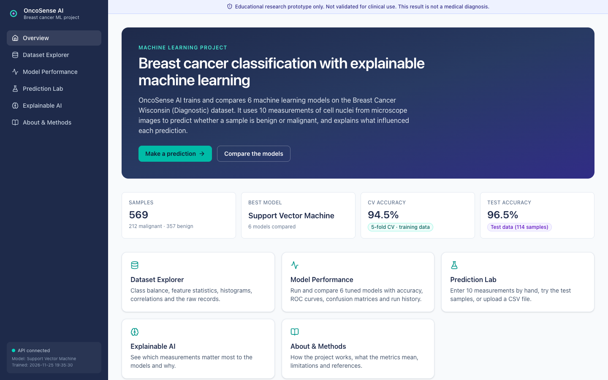

## Contents

1. [Features](#features)
2. [Tech stack](#tech-stack)
3. [Dataset](#dataset)
4. [How the machine learning works](#how-the-machine-learning-works)
5. [Results](#results)
6. [Installation and running](#installation-and-running)
7. [How to use the app (with screenshots)](#how-to-use-the-app)
8. [API endpoints](#api-endpoints)
9. [Tests](#tests)
10. [Project structure](#project-structure)
11. [Limitations](#limitations)
12. [References](#references)

## Features

| Page | What you can do |
|---|---|
| **Overview** | Project summary, live results of the best model, and how the project works |
| **Dataset Explorer** | Class balance, histograms by class for any measurement, a correlation heatmap, a scatter plot, a statistics table and paginated raw records |
| **Model Performance** | **Run models** with one click. See the best model and why it was chosen, a comparison table (accuracy, precision, recall, specificity, F1, ROC-AUC, tuned settings, training time), an accuracy chart, ROC curves, confusion matrices for every model, and the training history |
| **Prediction Lab** | **Manual input** of 10 measurements with simple names, **test-sample explorer** (the real diagnosis stays hidden until you reveal it), and **CSV batch** prediction with validation and a download button |
| **Explainable AI** | Permutation importance, Random Forest importance, Logistic Regression coefficients, and a glossary of the measurements |
| **About & Methods** | Method, the 6 models, what each metric means, limitations and references |

Every prediction shows:
- the **prediction level** (Low < 30%, Medium 30–70%, High ≥ 70% chance of malignant)
- the **chance of malignant** in % and the **predicted class**
- a warning if any value is outside the range seen in the dataset
- a **Shapley value** chart showing which measurements pushed the result towards benign or malignant

## Tech stack

| Part | Tools |
|---|---|
| Machine learning | Python 3.11+, scikit-learn, pandas, NumPy |
| Backend API | FastAPI, Pydantic, Uvicorn |
| Frontend | React 19, TypeScript, Vite, Tailwind CSS, Recharts (charts), Lucide (icons) |
| Tests | pytest (14 tests), plus a headless-Chrome check of every page |

Everything is free and runs offline on a normal laptop. No GPU or API key is needed.

## Dataset

[Breast Cancer Wisconsin (Diagnostic)](https://archive.ics.uci.edu/dataset/17/breast+cancer+wisconsin+diagnostic),
UCI Machine Learning Repository (built into scikit-learn, so nothing needs to be downloaded).

- **569 samples**: 357 benign (62.7%) and 212 malignant (37.3%). No missing values.
- Each sample describes the cell nuclei in a digitised microscope image of a fine needle aspirate (FNA) of a breast mass.
- This project uses the **10 “mean” measurements** and gives them simple names:

| Name in the app | Original column | Meaning |
|---|---|---|
| Cell radius | mean radius | Average distance from the centre of the nucleus to its edge |
| Texture | mean texture | How much the grey colour varies inside the cell |
| Cell perimeter | mean perimeter | Length of the outline of the nucleus |
| Cell area | mean area | Size of the nucleus |
| Smoothness | mean smoothness | How smooth the edge is |
| Compactness | mean compactness | How tightly packed the shape is |
| Concavity | mean concavity | How deep the inward curves of the edge are |
| Concave points | mean concave points | How many inward curves the edge has |
| Symmetry | mean symmetry | How symmetrical the cell is |
| Edge roughness | mean fractal dimension | How rough or irregular the edge is |

## How the machine learning works

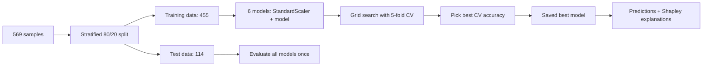

1. **Split**: 80% training data (455 samples) and 20% test data (114 samples), stratified so both have the same class
   ratio. The random seed is fixed (42), so results can be reproduced.
2. **Models**: Logistic Regression, Decision Tree, Random Forest, K-Nearest Neighbors, Support Vector Machine (RBF)
   and Gaussian Naive Bayes. Each is a pipeline `StandardScaler → model`, so scaling is learned from training data only.
3. **Tuning**: `GridSearchCV` with 5-fold stratified cross-validation tries a few settings per model
   (for example `C` for SVM and Logistic Regression, `n_neighbors` for KNN, `max_depth` for the trees).
4. **Model selection**: the model with the highest **cross-validation accuracy** is chosen (the lower CV spread
   breaks ties). The test data is **not** used for this choice.
5. **Evaluation**: every model is evaluated once on the test data: accuracy, precision, recall, specificity, F1,
   ROC-AUC, confusion matrix and ROC curve. Malignant is the positive class.
6. **Prediction level**: the best model's probability of malignant is shown as Low (< 30%), Medium (30–70%) or
   High (≥ 70%). The predicted class is Malignant when the probability is 50% or more.
7. **Explanation**: exact **Shapley values** compare the sample with an average training sample. With 10
   measurements there are 2^10 = 1024 combinations, which takes a few milliseconds. The contributions add up exactly to
   the difference between the two predictions.

## Results

Real results from `python train.py` (random seed 42). CV = mean ± standard deviation of 5-fold cross-validation on the
training data. All other columns are on the 114 test samples.

| Model | CV accuracy | Test accuracy | Precision | Recall | Specificity | F1 | ROC-AUC | Tuned settings |
|---|---|---|---|---|---|---|---|---|
| Logistic Regression | 94.1% ± 1.1 | 92.1% | 92.3% | 85.7% | 95.8% | 88.9% | 0.985 | C = 0.1 |
| Decision Tree | 94.3% ± 1.6 | 92.1% | 92.3% | 85.7% | 95.8% | 88.9% | 0.920 | max_depth = 3 |
| Random Forest | 94.5% ± 2.0 | 94.7% | 92.9% | 92.9% | 95.8% | 92.9% | 0.986 | 200 trees |
| K-Nearest Neighbors | 94.3% ± 2.0 | 94.7% | 90.9% | 95.2% | 94.4% | 93.0% | 0.975 | k = 7 |
| **Support Vector Machine (best)** | **94.5% ± 1.0** | **96.5%** | **95.2%** | **95.2%** | **97.2%** | **95.2%** | **0.982** | C = 5 |
| Naive Bayes | 92.1% ± 2.6 | 89.5% | 89.5% | 81.0% | 94.4% | 85.0% | 0.977 | — |

**Best model: Support Vector Machine.** It tied with Random Forest on CV accuracy (94.5%) and won the tie because its
results varied less between folds (± 1.0 vs ± 2.0). On the test data it classified 110 of 114 samples correctly:
2 malignant samples were missed and 2 benign samples were wrongly flagged.

With only 114 test samples, one mistake changes accuracy by almost 1 percentage point, so small differences
between models are not meaningful.

## Installation and running

**Requirements:** Python 3.11 or newer, Node.js 20 or newer, and Git.

### 1. Clone the project

```bash
git clone https://github.com/roshan-ds-tech/cancer_detection.git
cd cancer_detection
```

### 2. Start the backend (terminal 1)

macOS / Linux:

```bash
python3 -m venv .venv
source .venv/bin/activate
pip install -r backend/requirements.txt
cd backend
uvicorn main:app --port 8000
```

Windows (PowerShell):

```powershell
py -3.12 -m venv .venv
.venv\Scripts\Activate.ps1
pip install -r backend\requirements.txt
cd backend
uvicorn main:app --port 8000
```

The first time it starts, the server trains all models automatically (about 2 seconds) and saves the best one in
`backend/saved/`. To train from the terminal and see the results table, run `python train.py` in `backend/`.

Check that it works: open http://localhost:8000/api/health. Interactive API docs are at http://localhost:8000/docs.

### 3. Start the frontend (terminal 2)

```bash
cd frontend
npm install
npm run dev
```

### 4. Open the app

Go to **http://localhost:5180**. The sidebar shows a green **API connected** badge when the backend is running.

## How to use the app

### 1. Overview

The home page explains the project and shows live results from the API: the number of samples, the best model, and
its CV and test accuracy. Use the buttons to go straight to the Prediction Lab or the model comparison.


### 2. Explore the dataset

Open **Dataset Explorer**.
1. The top cards show the number of samples per class and the data quality (no missing values or duplicates).
2. **Distribution by class**: choose a measurement from the dropdown to compare the benign (blue) and malignant
   (purple) histograms.
3. **Feature correlations**: a heatmap with the correlation between every pair of measurements. Hover over a cell to
   read it. Radius, perimeter and area are almost perfectly correlated.
4. **Cell radius vs texture**: a scatter plot of all 569 samples.
5. Further down: a statistics table and the raw records with Previous / Next buttons.

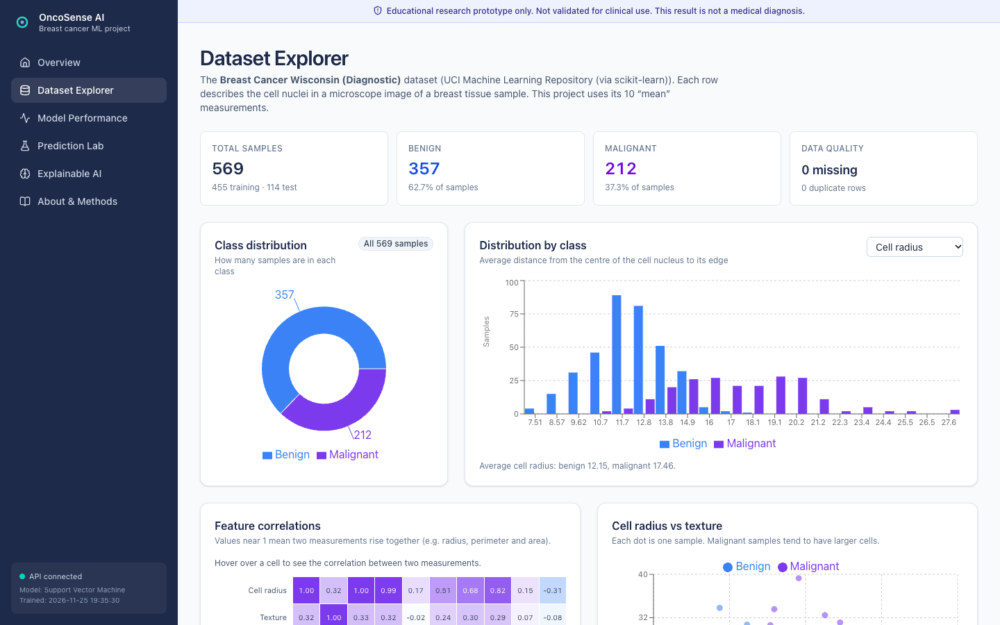
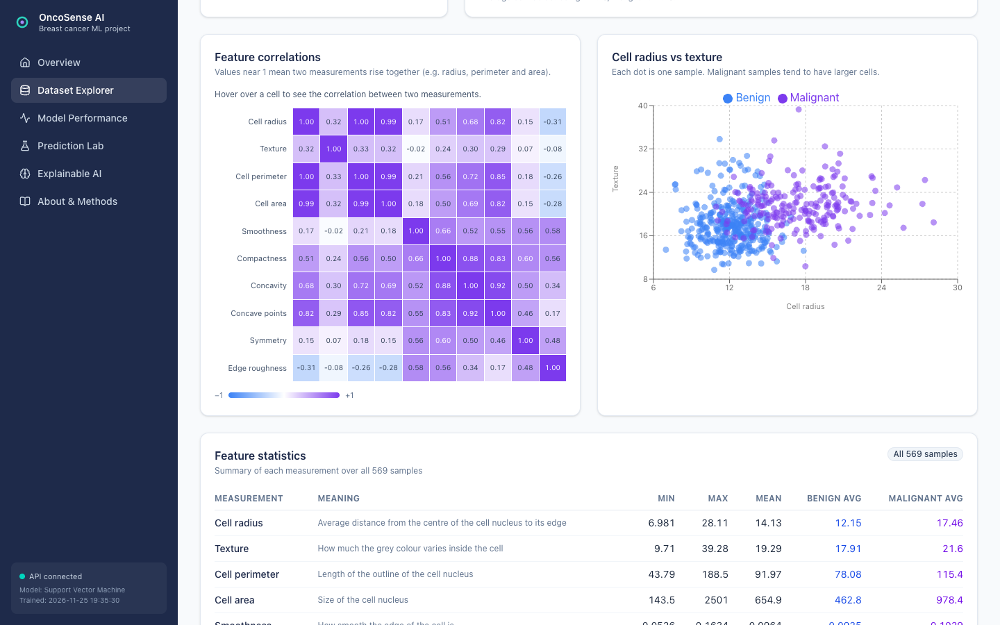

### 3. Run and compare the models

Open **Model Performance**.
1. Click **Run models** (top right). All 6 models are tuned and trained again, which takes about 2 seconds.
2. The **Best model** card shows which model was chosen and why, its tuned settings, and its test results.
3. The **Model comparison** table lists every metric for every model. The best model is highlighted.
4. The **Accuracy comparison** chart compares CV accuracy with test accuracy. The **ROC curves** chart shows all
   models; click a model's name to hide or show it.
5. **Confusion matrices** show for each model how many test samples were correct, missed or false alarms.
6. **Training history** lists every run with its date, best model and accuracy.

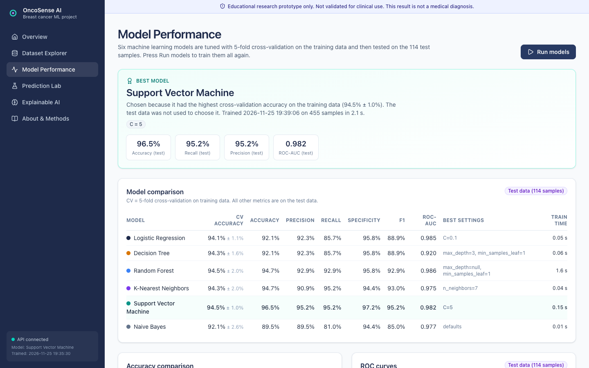
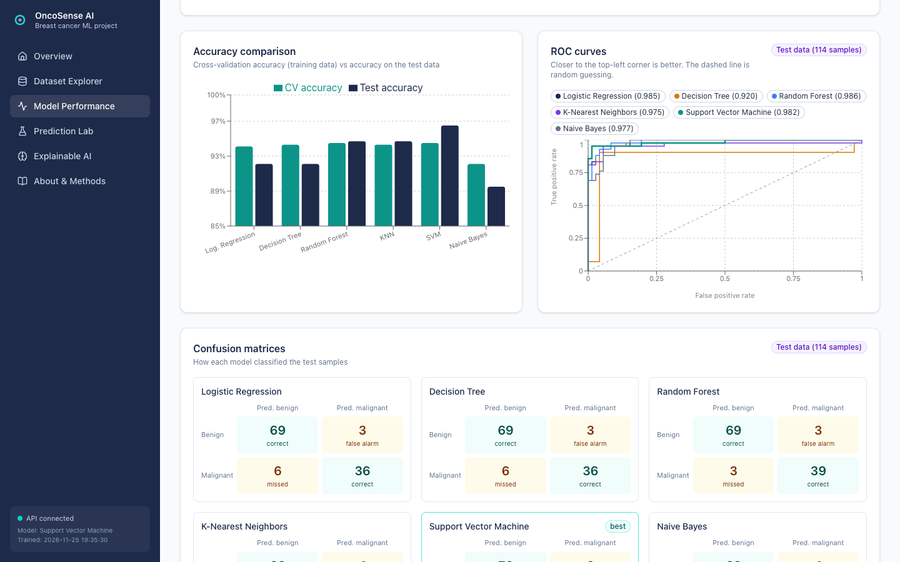
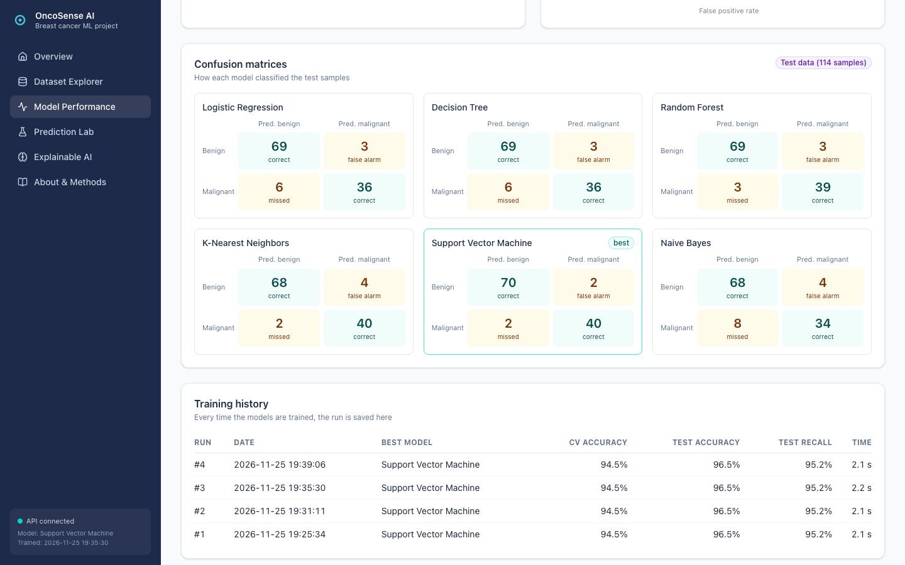

### 4. Make a prediction (manual input)

Open **Prediction Lab**. The **Manual input** tab is selected.
1. Type the 10 measurements. Under each box you can see what it means and the range found in the dataset. Values
   outside that range are highlighted.
2. Not sure what to enter? Click **Fill typical benign values** or **Fill typical malignant values**.
3. Click **Predict**. Empty, non-numeric or negative values are marked and nothing is sent.
4. The result shows the **prediction level**, the **chance of malignant**, the **predicted class**, and whether all
   values are inside the dataset range.
5. **What influenced this prediction** shows the Shapley value of each measurement. Purple bars push towards
   malignant, blue bars towards benign.

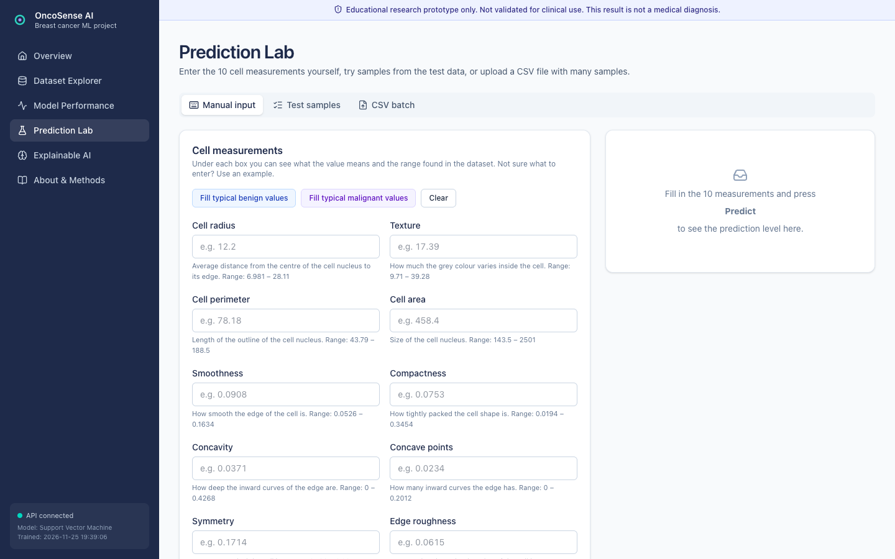

| Typical malignant values: High | Typical benign values: Low |
|---|---|
| 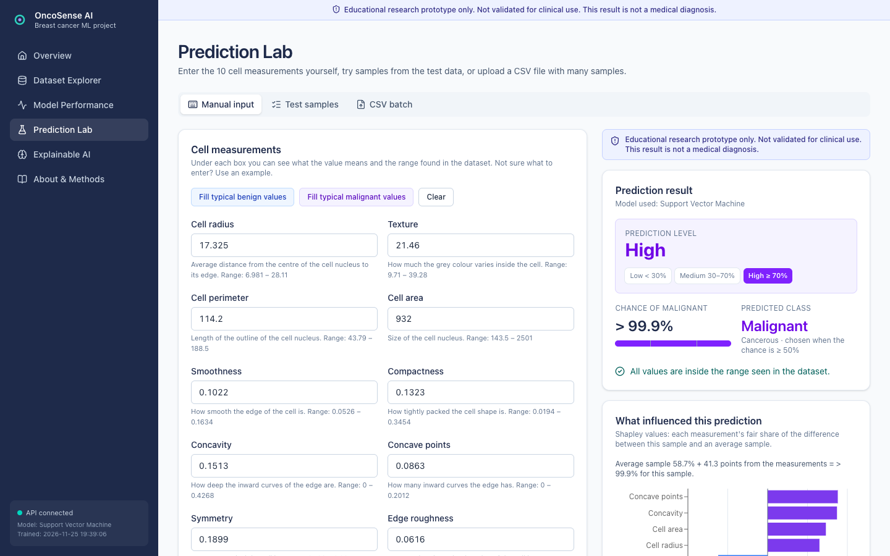 | 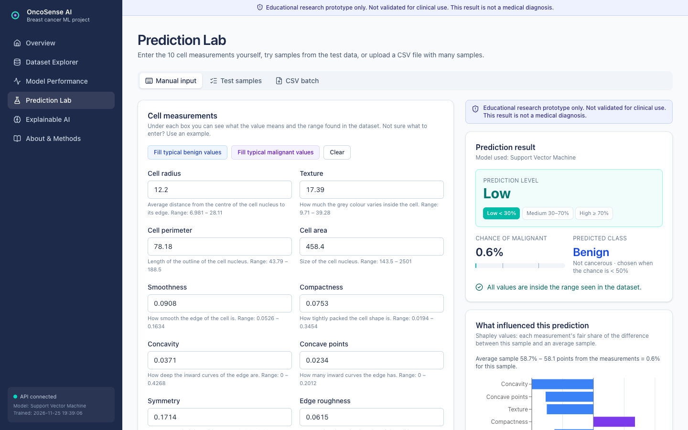 |

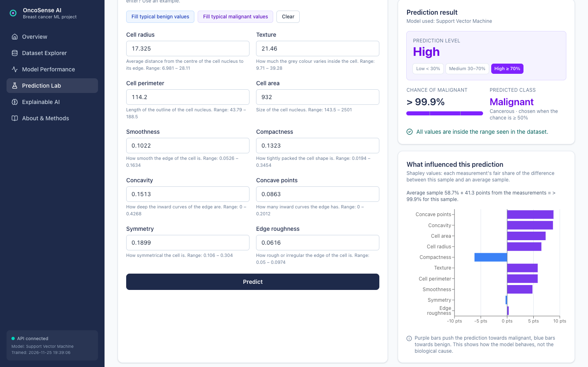

### 5. Try the test samples

In the **Test samples** tab, choose one of the 114 test samples (or press **Random**) and click **Predict**. The
sample's measurements are shown on the left. Press **Reveal real diagnosis** to see whether the model was right.

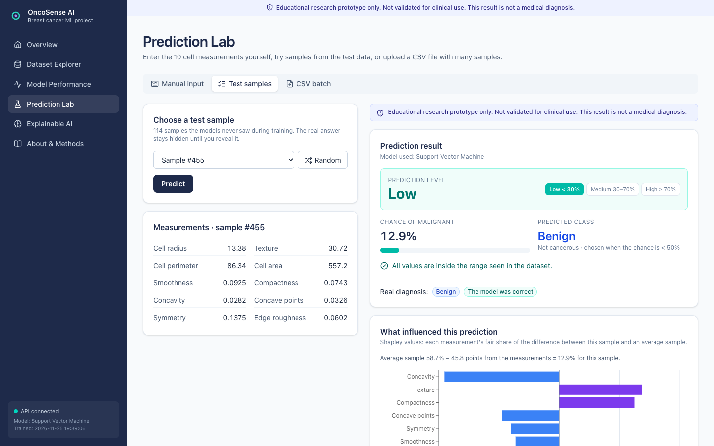

### 6. Predict many samples from a CSV file

In the **CSV batch** tab:
1. Click **Template CSV** to download a file in the right format.
2. The first line must contain the 10 column names (`radius, texture, perimeter, area, smoothness, compactness,
   concavity, concave_points, symmetry, fractal_dimension`), plus an optional `id` column.
3. Choose your file and click **Upload & predict**. Each row gets a level and a prediction. Rows with invalid values
   are reported with the reason and are not guessed. Files with wrong columns are rejected.
4. Click **Download CSV** to save the results. Limits: 1 MB and 1,000 rows. Uploaded files are not stored.

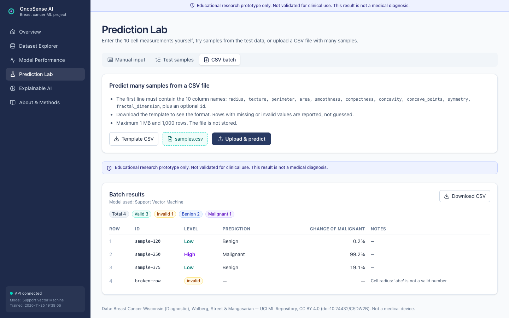

### 7. Explainable AI and About

**Explainable AI** compares three ways of measuring which measurements matter. **About & Methods** explains the method,
the models, each metric and the limitations.

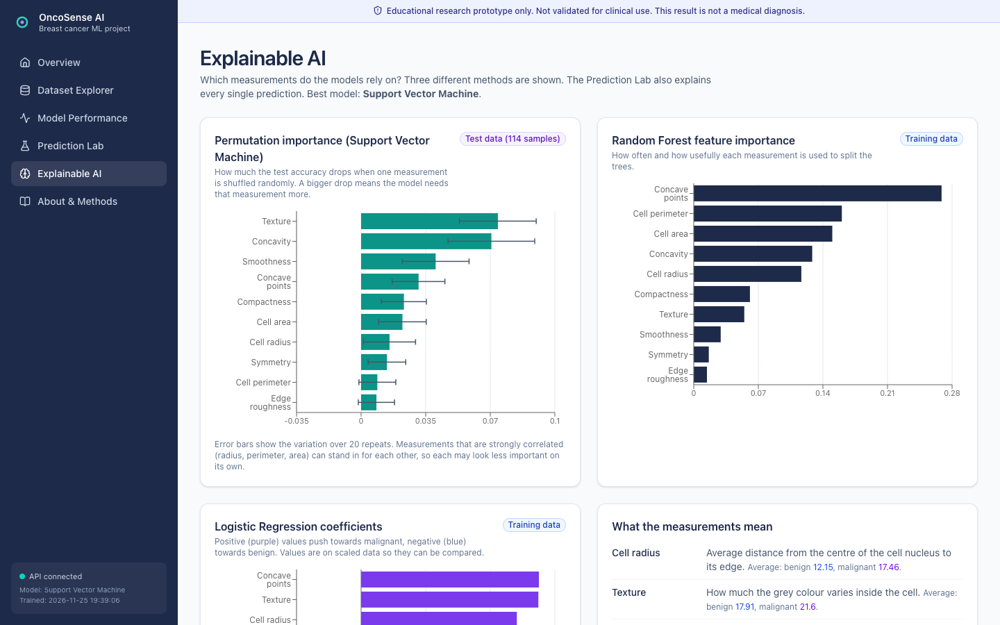
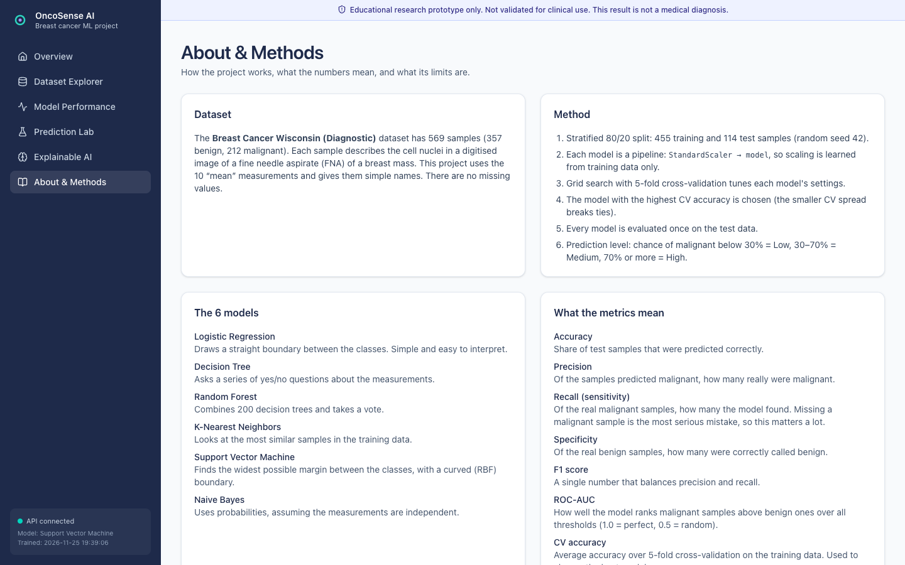

The app also works on a phone:

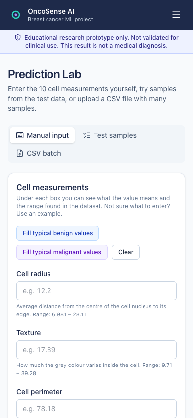

## API endpoints

| Method | URL | Description |
|---|---|---|
| GET | `/api/health` | Server status, best model and training time |
| GET | `/api/dataset/summary` | Counts, data quality and statistics for each measurement |
| GET | `/api/dataset/eda` | Histograms, correlation matrix and scatter data |
| GET | `/api/dataset/records?limit=20&offset=0` | Raw records, one page at a time |
| GET | `/api/models/results` | Results of the latest training run |
| POST | `/api/models/train` | Train and compare all models again |
| GET | `/api/models/history` | All training runs |
| POST | `/api/predict` | Predict one sample from the 10 measurements (JSON) |
| GET | `/api/samples` | The 114 test samples (without their labels) |
| POST | `/api/predict/sample/{id}` | Predict a test sample and return its real diagnosis |
| POST | `/api/predict/batch` | Predict every row of an uploaded CSV file |
| GET | `/api/predict/template.csv` | CSV template |

Example:

```bash
curl -X POST http://localhost:8000/api/predict -H "Content-Type: application/json" -d '{
  "radius": 17.3, "texture": 21.5, "perimeter": 114.2, "area": 932, "smoothness": 0.102,
  "compactness": 0.132, "concavity": 0.151, "concave_points": 0.086, "symmetry": 0.19, "fractal_dimension": 0.062
}'
```

## Tests

```bash
cd backend
pytest                      # 14 tests

cd frontend
npm run build               # type check + production build
npm run screenshots         # opens every page in headless Chrome, checks for errors and
                            # mobile layout problems, and saves the README screenshots
```

The backend tests check:
- the dataset and the train/test split;
- that all 6 models are trained and the best one has the highest CV accuracy;
- the prediction levels and the benign/malignant examples;
- that invalid input is rejected;
- that the Shapley contributions add up;
- that test-sample and CSV batch predictions work, including wrong files.

`npm run screenshots` needs both servers running and Google Chrome installed.

## Project structure

```
cancer_detection/
├── backend/
│   ├── data.py            # dataset loading, train/test split, statistics and EDA data
│   ├── training.py        # 6 models, grid search, evaluation, feature importance, history
│   ├── predictor.py       # predictions, prediction level, Shapley explanations, CSV batch
│   ├── main.py            # FastAPI server with all endpoints
│   ├── train.py           # train from the terminal and print the results table
│   ├── test_app.py        # pytest tests
│   ├── requirements.txt
│   └── saved/             # trained model, results and history (created automatically)
├── frontend/
│   ├── src/
│   │   ├── pages/         # Home, Dataset, Models, Predict, Explain, About
│   │   ├── components/    # Layout (sidebar), cards, charts, prediction result, heatmap
│   │   └── lib/           # API client, types, formatting helpers
│   └── e2e/readme_screenshots.mjs
└── docs/screenshots/      # screenshots used in this README
```

## Limitations

- The dataset is small (569 samples) and comes from one hospital in the early 1990s. The models were not tested on
  data from other hospitals.
- The test set has only 114 samples, so the results have a wide margin of error.
- The measurements come from a special image analysis process. They are not values from a normal medical report.
- The “outside the dataset range” warning is a simple check, not a guarantee.
- High accuracy on this dataset does **not** mean the model would work on real patients. This project is for
  learning only and is not a medical device.

## References

- Wolberg, W., Mangasarian, O., Street, N., & Street, W. (1993). *Breast Cancer Wisconsin (Diagnostic)* [Dataset].
  UCI Machine Learning Repository. https://doi.org/10.24432/C5DW2B (CC BY 4.0)
- Street, W. N., Wolberg, W. H., & Mangasarian, O. L. (1993). Nuclear feature extraction for breast tumor diagnosis.
  *SPIE Biomedical Image Processing and Biomedical Visualization*, 1905.
- Pedregosa, F. et al. (2011). Scikit-learn: Machine Learning in Python. *JMLR*, 12. https://scikit-learn.org
- Lundberg, S. M., & Lee, S.-I. (2017). A Unified Approach to Interpreting Model Predictions (Shapley values / SHAP). *NeurIPS*.
