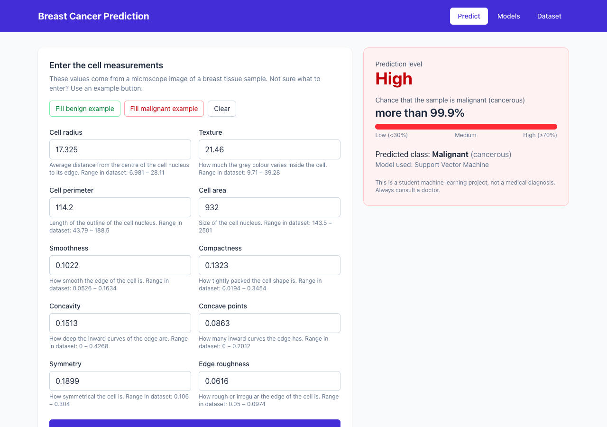
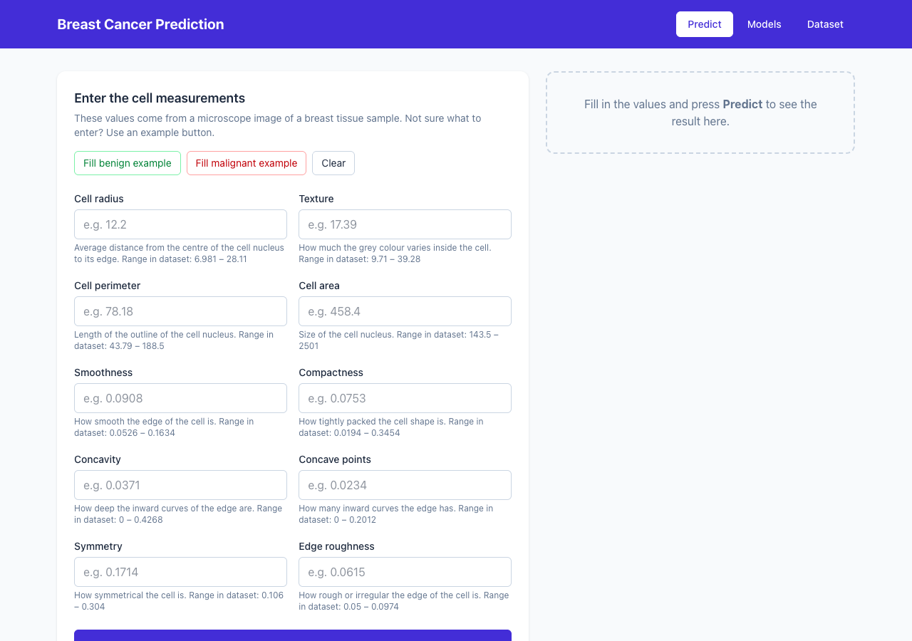
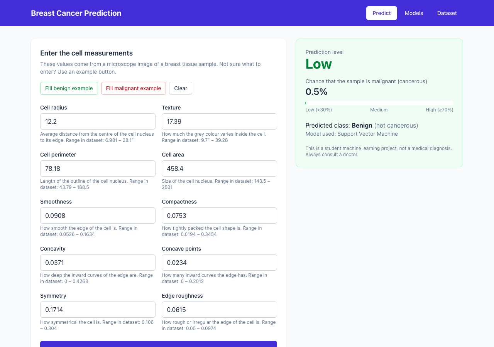
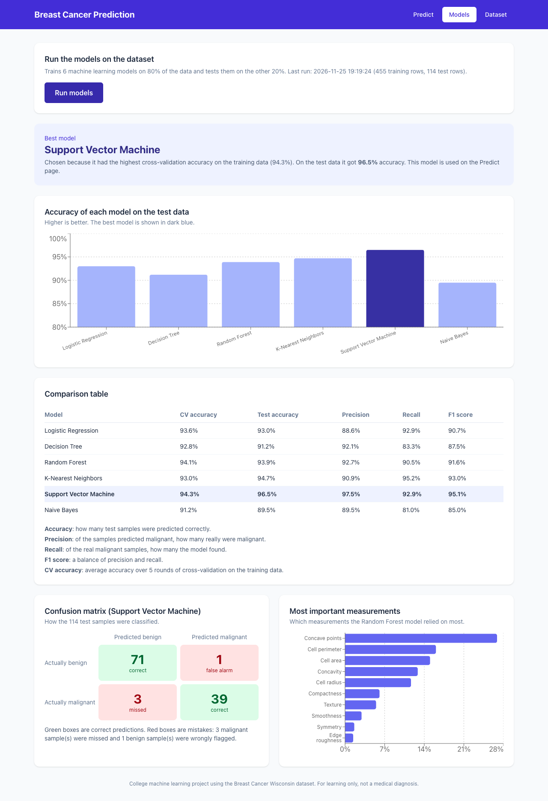
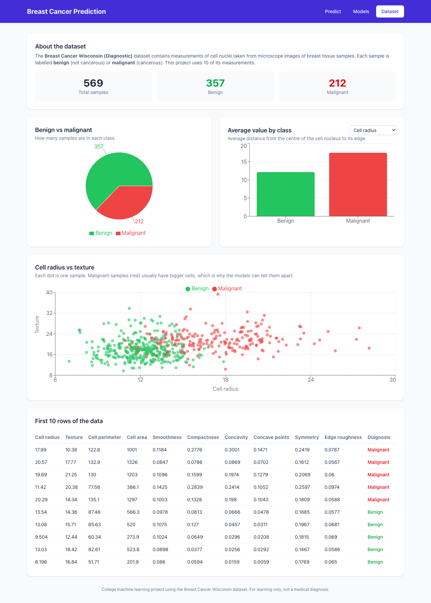
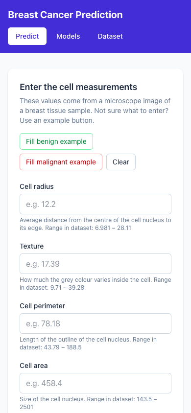

# Breast Cancer Prediction (ML College Project)

A simple web app that uses machine learning to predict whether a breast tissue sample is **benign** (not cancerous)
or **malignant** (cancerous), based on 10 measurements of the cell nuclei.

It trains and compares **6 machine learning models** on the Breast Cancer Wisconsin dataset, picks the best one,
and lets you enter values in a form to get a prediction level of **Low**, **Medium** or **High**.

> This is a student project for learning. It is **not** a medical tool and must not be used to diagnose anyone.



## Features

- **Predict page**: enter 10 cell measurements with easy names and get the prediction level, the chance of
  being malignant (%) and the predicted class.
- **Models page**: one click runs all 6 models on the dataset and shows their accuracy in a bar chart, a comparison
  table, a confusion matrix and the most important measurements.
- **Dataset page**: easy charts that explain the data (class counts, averages, a scatter plot and sample rows).

## Technologies used

| Part | Tools |
|---|---|
| Machine learning | Python, scikit-learn, pandas |
| Backend (API) | FastAPI |
| Frontend (website) | React, TypeScript, Tailwind CSS, Recharts (charts) |

## Dataset

[Breast Cancer Wisconsin (Diagnostic)](https://archive.ics.uci.edu/dataset/17/breast+cancer+wisconsin+diagnostic)
from the UCI Machine Learning Repository. It is built into scikit-learn, so nothing needs to be downloaded.

- 569 samples: 357 benign and 212 malignant
- This project uses the 10 "mean" measurements:

| Name in the app | Original column | Meaning |
|---|---|---|
| Cell radius | mean radius | Average distance from the centre of the nucleus to its edge |
| Texture | mean texture | How much the grey colour varies inside the cell |
| Cell perimeter | mean perimeter | Length of the outline of the nucleus |
| Cell area | mean area | Size of the nucleus |
| Smoothness | mean smoothness | How smooth the edge is |
| Compactness | mean compactness | How tightly packed the shape is |
| Concavity | mean concavity | How deep the inward curves of the edge are |
| Concave points | mean concave points | How many inward curves the edge has |
| Symmetry | mean symmetry | How symmetrical the cell is |
| Edge roughness | mean fractal dimension | How rough or irregular the edge is |

## How it works

1. The dataset is split into **80% training data** (455 rows) and **20% test data** (114 rows).
2. Each of the 6 models is trained on the training data. The values are scaled first with `StandardScaler`.
3. Each model is checked with **5-fold cross-validation** on the training data. The model with the highest
   cross-validation accuracy is chosen as the best model.
4. All models are then tested on the test data, which they have never seen before.
5. The best model is saved and used for predictions on the Predict page.

**Prediction level.** The model gives the chance (probability) that a sample is malignant:

| Chance of malignant | Level |
|---|---|
| less than 30% | Low |
| 30% to 70% | Medium |
| 70% or more | High |

The predicted class is *Malignant* if the chance is 50% or more, otherwise *Benign*.

## Results

These are the results of one run with random seed 42 (the numbers can change slightly if the code changes):

| Model | CV accuracy | Test accuracy | Precision | Recall | F1 score |
|---|---|---|---|---|---|
| Logistic Regression | 93.6% | 93.0% | 88.6% | 92.9% | 90.7% |
| Decision Tree | 92.8% | 91.2% | 92.1% | 83.3% | 87.5% |
| Random Forest | 94.1% | 93.9% | 92.7% | 90.5% | 91.6% |
| K-Nearest Neighbors | 93.0% | 94.7% | 90.9% | 95.2% | 93.0% |
| **Support Vector Machine (best)** | **94.3%** | **96.5%** | **97.5%** | **92.9%** | **95.1%** |
| Naive Bayes | 91.2% | 89.5% | 89.5% | 81.0% | 85.0% |

The best model (Support Vector Machine) classified 110 of the 114 test samples correctly.
It missed 3 malignant samples and wrongly flagged 1 benign sample.

## How to run the project

You need **Python 3.11 or newer** and **Node.js 20 or newer**.

### 1. Download the project

```bash
git clone https://github.com/roshan-ds-tech/cancer_detection.git
cd cancer_detection
```

### 2. Start the backend (terminal 1)

```bash
python3 -m venv .venv
source .venv/bin/activate          # on Windows: .venv\Scripts\activate
pip install -r backend/requirements.txt
cd backend
uvicorn main:app --port 8000
```

The first time it starts, it trains the models automatically (this takes a few seconds).
You can also train them yourself and see the results in the terminal with `python train.py`.

### 3. Start the frontend (terminal 2)

```bash
cd frontend
npm install
npm run dev
```

### 4. Open the app

Go to **http://localhost:5180** in your browser.

## How to use the app

### Step 1: Enter the measurements

Open the **Predict** page. Type the 10 values into the form. Under each box you can see what the value means and
the range found in the dataset. If you don't have real values, click **Fill benign example** or
**Fill malignant example** to fill the form with typical values from the dataset.



### Step 2: Click Predict

The result card shows:
- the **prediction level** (Low / Medium / High)
- the **chance of being malignant** in %, with a coloured bar
- the **predicted class** (Benign or Malignant) and the model that was used

If a value is outside the range seen in the dataset, a warning is shown because the result may not be reliable.

| Benign example: Low | Malignant example: High |
|---|---|
|  |  |

### Step 3: Run and compare the models

Open the **Models** page and click **Run models**. All 6 models are trained on the dataset again and the page
shows:
- which model is the **best** and why
- a **bar chart** of the test accuracy of each model
- a **comparison table** with accuracy, precision, recall and F1 score, with a short explanation of each
- the **confusion matrix** of the best model (green = correct, red = mistakes)
- the **most important measurements**, according to the Random Forest model



### Step 4: Explore the dataset

Open the **Dataset** page to see how many samples are benign and malignant, compare the average of any
measurement between the two classes, see a scatter plot of cell radius vs texture, and look at some rows of the data.



The app also works on a phone:



## Project structure

```
cancer_detection/
├── backend/
│   ├── model.py           # loads the data, trains the 6 models, makes predictions
│   ├── main.py            # FastAPI server (the API used by the website)
│   ├── train.py           # train the models from the terminal and print the results
│   ├── test_app.py        # tests
│   └── requirements.txt   # Python libraries
├── frontend/
│   ├── src/
│   │   ├── App.tsx        # page layout and navigation
│   │   ├── api.ts         # functions that call the backend
│   │   └── pages/         # Predict.tsx, Models.tsx, Dataset.tsx
│   └── e2e/readme_screenshots.mjs   # takes the screenshots in this README
└── docs/screenshots/      # screenshots used in this README
```

## API endpoints

| Method | URL | What it does |
|---|---|---|
| GET | `/api/dataset` | Dataset information and chart data |
| GET | `/api/results` | Results of the last model run |
| POST | `/api/train` | Runs all 6 models again and returns the results |
| POST | `/api/predict` | Predicts one sample from the 10 values |

You can try the API in your browser at http://localhost:8000/docs.

## Running the tests

```bash
cd backend
pytest
```

The 6 tests check that the dataset loads correctly, that all models are trained, that the prediction levels are
right, that the benign and malignant examples are predicted correctly, and that wrong input is rejected.

## Limitations

- The dataset is small (569 samples) and comes from one hospital in the 1990s.
- The measurements come from a special microscope image process, so you can't type in values from a normal
  medical report.
- High accuracy on this dataset does not mean the model would work on real patients.

## References

- W. H. Wolberg, W. N. Street, O. L. Mangasarian. *Breast Cancer Wisconsin (Diagnostic)* dataset, UCI Machine Learning
  Repository, 1993. https://doi.org/10.24432/C5DW2B
- scikit-learn documentation: https://scikit-learn.org
