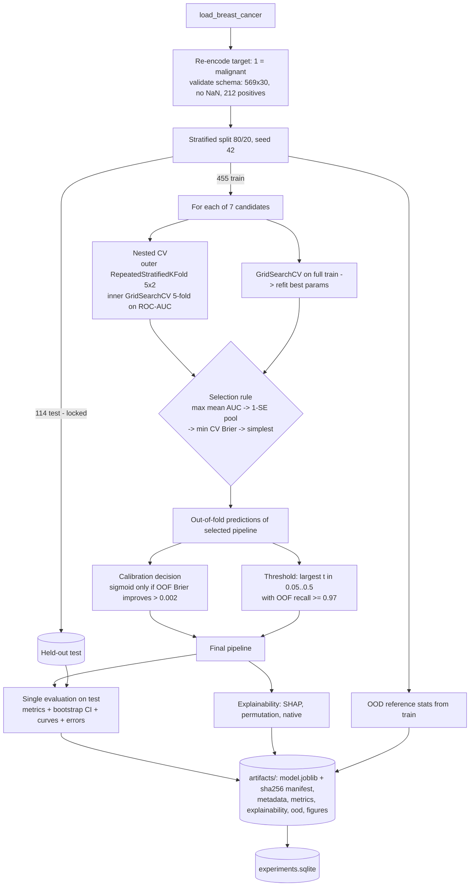

# ML Methodology (implementation)

Code: `backend/app/ml/`. Entry point: `python scripts/train_models.py [--quick] [--seed N]`.

## Training workflow

## Candidates and grids

The grids are deliberately small so that a full run takes about 45 s on a laptop CPU.

| Key | Pipeline | Grid |
|---|---|---|
| logistic_regression | StandardScaler → LogisticRegression(L2, max_iter 5000) | C ∈ {0.01, 0.1, 1, 10} |
| svm | StandardScaler → CalibratedClassifierCV(SVC(rbf), sigmoid, cv=5, ensemble=False) | C ∈ {0.1, 1, 10}, γ ∈ {scale, 0.01} |
| random_forest | RandomForest(200 trees) | max_depth ∈ {None, 6}, min_samples_leaf ∈ {1, 3} |
| decision_tree | DecisionTree | max_depth ∈ {3, 5, None}, min_samples_leaf ∈ {1, 5} |
| knn | StandardScaler → KNN | k ∈ {3, 5, 9, 15}, weights ∈ {uniform, distance} |
| gaussian_nb | GaussianNB | var_smoothing ∈ {1e-9, 1e-7, 1e-5} |
| gradient_boosting (optional) | GradientBoosting | n_estimators ∈ {100, 200}, max_depth ∈ {2, 3} |

**Probability sources.**

- LR gives native probabilities.
- The SVM uses Platt scaling via `CalibratedClassifierCV(ensemble=False)`. This is the documented replacement for `SVC(probability=True)`, which is deprecated in scikit-learn 1.9.
- RF, KNN and DT give vote or leaf fractions, which are coarse.
- NB gives a posterior that tends to be over-confident here because its independence assumption is violated.

These differences are reported per model, and the Brier score makes them visible.

**Not included.** XGBoost is not installed, and scikit-learn's GradientBoosting covers boosted trees. A neural network was also left out: with 455 rows and strong linear baselines it would add little, and it would be harder to audit.

## Selection rule (why not "highest test accuracy")

1. Compute the mean and SE of outer-fold ROC-AUC for each model.
2. The pool is every model with mean AUC ≥ best mean − best SE, because differences smaller than that are noise.
3. Within the pool, choose the lowest mean CV Brier, which rewards better probability estimates.
4. If still tied, choose the lower complexity rank.

In this run the pool was {LR, SVM}. The SVM won on Brier (0.0214 vs 0.0228).

## Threshold

The default threshold of 0.5 treats false negatives and false positives as equally costly. In a screening-like setting,
missing a malignant sample is usually considered worse. The operating threshold is therefore the **largest** threshold in
[0.05, 0.5] whose out-of-fold training recall is at least 0.97. Taking the largest such threshold keeps specificity as high as possible. The result was 0.39. The cap at 0.5 prevents the threshold from rising above the neutral point. Test metrics are reported at both 0.5 and 0.39.

## Explainability methods

| Method | Scope | Implementation | Caveat |
|---|---|---|---|
| SHAP (permutation) | Local and global | `shap.explainers.Permutation` on P(malignant) of the full pipeline; independent masker with 50 training rows; max_evals 261; seeded | Interventional: may evaluate unrealistic feature combinations when features are correlated |
| Permutation importance | Global, every model | `sklearn.inspection.permutation_importance`, scoring ROC-AUC, 20 repeats, on the test split | Understates importance for correlated features |
| Native | Global | LR standardised coefficients; tree impurity importances | Coefficients are unstable under collinearity; impurity is biased and computed on training data |

SHAP additivity holds: base value + Σ contributions = predicted probability. The API test suite asserts this to within 1e-6.

## Out-of-distribution heuristic

The heuristic is fitted on training data (`app/ml/ood.py`):

- **Per feature.** Flag a value outside [min, max] or with |robust z| > 4, where robust z = (x − median)/(IQR/1.349). **Abstain** if a value lies beyond the training range by more than 50% of that range.
- **Multivariate.** Mahalanobis distance on standardised features with Ledoit-Wolf covariance. **Warn** above the training 99th percentile (12.75). **Abstain** above 2 × the training maximum (2 × 16.75).
- These are heuristics and not a validated OOD detector. The UI says so.

## Reproducibility

The seed is fixed for the split, the CV splitters, the models and SHAP. Versions are recorded in metadata (Python 3.12.15, scikit-learn 1.9.1, NumPy 2.5.5, pandas 3.1.1, SHAP 0.54.1). The dataset fingerprint is a SHA-256 over X and y. Nested CV with `n_jobs=-1` is deterministic for these estimators, given the seeds.
