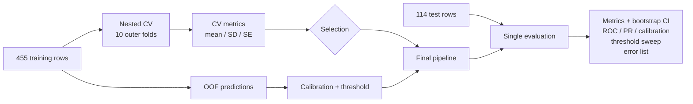

# Model Evaluation

> Educational research prototype only. Not validated for clinical use. These numbers describe one dataset and one split.

Source: `backend/artifacts/metrics.json` and `metadata.json`, run `20261125T114504Z-d23509`, seed 42. Positive class = malignant.

## 1. Cross-validation (training split, used for selection)

Nested CV with outer RepeatedStratifiedKFold(5 × 2) and an inner 5-fold grid search. Values are mean ± SD over 10 outer folds at threshold 0.5.

| Model | ROC-AUC | Recall | Specificity | F1 | Accuracy | Brier |
|---|---|---|---|---|---|---|
| Logistic Regression | 0.9950 ± 0.0059 | 0.950 ± 0.034 | 0.991 | 0.967 | 0.976 | 0.0228 |
| **SVM (RBF)**, selected | 0.9948 ± 0.0063 | 0.950 ± 0.039 | 0.982 | 0.960 | 0.970 | 0.0214 |
| Gradient Boosting | 0.9924 ± 0.0066 | 0.941 ± 0.044 | 0.981 | 0.953 | 0.966 | 0.0270 |
| Gaussian NB | 0.9882 ± 0.0074 | 0.897 ± 0.081 | 0.963 | 0.914 | 0.938 | 0.0565 |
| Random Forest | 0.9878 ± 0.0095 | 0.929 ± 0.058 | 0.970 | 0.939 | 0.955 | 0.0349 |
| KNN | 0.9870 ± 0.0135 | 0.900 ± 0.070 | 0.995 | 0.942 | 0.959 | 0.0335 |
| Decision Tree | 0.9534 ± 0.0332 | 0.897 ± 0.061 | 0.949 | 0.905 | 0.930 | 0.0571 |

**Selection.** LR has the best mean AUC (0.9950, SE 0.0019). The SVM falls within one SE of it. Of the two, the SVM has the lower CV Brier, so it was selected. The two models are statistically indistinguishable, and the choice is a reasoned tie-break, not evidence of superiority.

## 2. Held-out test set: all models at threshold 0.5

These results are shown for transparency and were **not** used for selection.

| Model | Acc. | Prec. | Recall | Spec. | F1 | ROC-AUC | PR-AUC | Brier | TN/FP/FN/TP |
|---|---|---|---|---|---|---|---|---|---|
| Logistic Regression | 0.965 | 0.975 | 0.929 | 0.986 | 0.951 | 0.9960 | 0.9943 | 0.0213 | 71/1/3/39 |
| **SVM (RBF)** | 0.982 | 1.000 | 0.952 | 1.000 | 0.976 | 0.9960 | 0.9947 | 0.0179 | 72/0/2/40 |
| Random Forest | 0.965 | 1.000 | 0.905 | 1.000 | 0.950 | 0.9942 | 0.9911 | 0.0323 | 72/0/4/38 |
| Decision Tree | 0.904 | 0.919 | 0.810 | 0.958 | 0.861 | 0.9716 | 0.9530 | 0.0680 | 69/3/8/34 |
| KNN | 0.947 | 0.974 | 0.881 | 0.986 | 0.925 | 0.9957 | 0.9930 | 0.0374 | 71/1/5/37 |
| Gaussian NB | 0.939 | 1.000 | 0.833 | 1.000 | 0.909 | 0.9934 | 0.9890 | 0.0590 | 72/0/7/35 |
| Gradient Boosting | 0.965 | 1.000 | 0.905 | 1.000 | 0.950 | 0.9934 | 0.9917 | 0.0282 | 72/0/4/38 |

## 3. Selected model at the operating threshold (0.39)

The threshold of 0.39 was fixed from out-of-fold training predictions, where it gave recall 0.971 and specificity 0.972.

| Metric | Value | 95% bootstrap CI |
|---|---|---|
| Accuracy | 0.982 | 0.956 – 1.000 |
| Recall (sensitivity) | 0.952 | 0.875 – 1.000 |
| Specificity | 1.000 | 1.000 – 1.000 |
| Precision | 1.000 | 1.000 – 1.000 |
| F1 | 0.976 | 0.933 – 1.000 |
| ROC-AUC | 0.996 | 0.985 – 1.000 |
| PR-AUC | 0.995 | 0.980 – 1.000 |
| Brier | 0.018 | 0.004 – 0.039 |

Confusion matrix: TN 72, FP 0, FN 2, TP 40. On this test split, thresholds 0.39 and 0.5 give identical results.

**On the degenerate intervals.** The specificity and precision CIs of [1, 1] are a known weakness of the percentile bootstrap when no errors occur. They do **not** mean that the true specificity is 1. A rule-of-three style bound for 0 errors in 72 benign samples gives an upper limit on the false-positive rate of about 4%.

## 4. Error analysis

| Sample ID | Type | P(malignant) |
|---|---|---|
| 99 | false negative | 0.345 |
| 73 | false negative | 0.051 |

Sample 99 is close to the threshold, so a lower threshold would catch it at the cost of more false positives (see the
threshold explorer). Sample 73 receives a low score. It looks benign to the model, and no reasonable threshold would catch it without
many false alarms. Missed cases like this are why a model of this kind cannot be used without clinical oversight.

## 5. Calibration

- The selected pipeline is already Platt-calibrated inside the SVM step. Extra sigmoid calibration did not improve OOF Brier (0.0182 → 0.0189), so none was applied.
- Test-set calibration curves use 8 quantile bins over 114 samples and are indicative only. Gaussian NB is the most over-confident model (Brier 0.059).
- The probabilities are calibrated to a population with 37% prevalence. They would not transfer to a different prevalence.

## 6. Learning curve

The validation ROC-AUC of the selected model is flat, from 0.994 at 72 training rows to 0.995 at 364 rows. More data of the same kind would barely change discrimination. The limitation is external validity, not sample size for this task.

## 7. Cost and speed

| Model | Refit (s) | Single-row inference (ms, median) | Serialised size |
|---|---|---|---|
| Logistic Regression | 0.002 | 0.23 | 2.1 KB |
| SVM (selected) | 0.007 | 0.39 | 15.9 KB |
| Random Forest | 0.107 | 3.04 | 129.7 KB |
| Decision Tree | 0.003 | 0.16 | 1.7 KB |
| KNN | 0.001 | 0.89 | 104.4 KB |
| Gaussian NB | 0.001 | 0.20 | 1.9 KB |
| Gradient Boosting | 0.221 | 0.23 | 39.8 KB |

An API prediction with a full SHAP explanation measured about 40 ms end to end on the development laptop.

## 8. Explainability results

| Rank | Global mean \|SHAP\| (selected SVM) | Permutation Δ AUC (selected) | LR standardised coef. |
|---|---|---|---|
| 1 | worst_texture 0.057 | worst_texture 0.0061 | worst_texture +1.43 |
| 2 | mean_concave_points 0.041 | texture_se 0.0028 | radius_se +1.23 |
| 3 | mean_concavity 0.035 | worst_radius 0.0020 | worst_symmetry +1.06 |
| 4 | worst_concavity 0.034 | worst_area 0.0016 | mean_concave_points +0.95 |
| 5 | worst_radius 0.034 | worst_smoothness 0.0015 | worst_concavity +0.91 |

Texture, concavity and size dominate. Permutation importances are tiny because AUC is near its ceiling and correlated
partners compensate when one feature is shuffled. All attributions describe **model behaviour**, not biology.

## 9. What these results do not show

They do not show clinical accuracy, generalisation to other centres, imaging systems or populations, prospective
performance, or benefit to patients. See [ETHICS_AND_LIMITATIONS.md](ETHICS_AND_LIMITATIONS.md).
