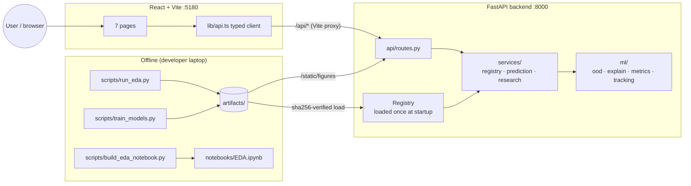
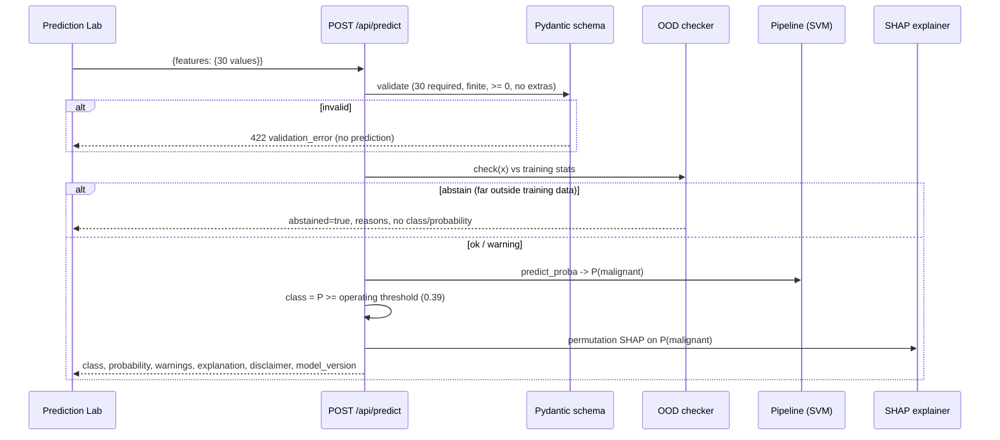
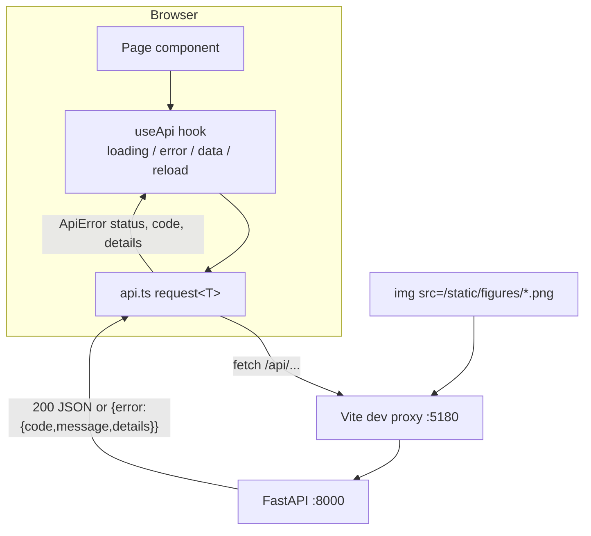
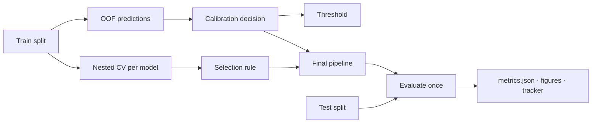

# System Architecture

## 1. Overall architecture

Key properties:

- **Training never runs in a request.** Artifacts are created offline, and the API only loads them.
- **ML code is separated from HTTP code.** `app/ml` has no FastAPI imports, and `app/api` contains no modelling logic.
- **Single source of truth.** Every number in the UI comes from artifacts written by the training and EDA scripts.

## 2. Inference workflow

## 3. Frontend–backend communication

- All errors use the same envelope: `{"error": {"code", "message", "details"}}`. The client turns it into `ApiError`, and pages render `ErrorState` with a Retry button.
- In production, set `VITE_API_BASE` or serve the frontend behind the same origin (see [DEPLOYMENT_GUIDE.md](DEPLOYMENT_GUIDE.md)).

## 4. Model evaluation pipeline

See [MODEL_EVALUATION.md](MODEL_EVALUATION.md) §0 and [ML_METHODOLOGY.md](ML_METHODOLOGY.md) for the training flow.

## 5. Components

| Module | Responsibility |
|---|---|
| `app/ml/data.py` | Load, re-encode, validate schema, fingerprint, split, feature specs |
| `app/ml/models.py` | Candidate pipelines and grids |
| `app/ml/training.py` | Full workflow: nested CV, selection, calibration, threshold, test evaluation, explainability, persistence, tracking |
| `app/ml/metrics.py` | Metrics with malignant = positive, bootstrap CIs, curves, threshold sweep |
| `app/ml/explain.py` | SHAP local explainer, permutation importance, native importance |
| `app/ml/ood.py` | Distribution-shift heuristics (JSON-serialisable) |
| `app/ml/artifacts.py` | JSON I/O, model save, hash-verified trusted load |
| `app/ml/tracking.py` | SQLite experiment tracker |
| `app/ml/eda.py`, `figures.py` | EDA statistics, static figures |
| `app/services/registry.py` | Loads all artifacts at startup; reports a degraded state if missing |
| `app/services/prediction.py` | Single and batch inference, CSV parsing and validation, CSV export |
| `app/services/research.py` | Methodology content with run-specific values injected |
| `app/api/routes.py` | Endpoints |
| `app/main.py` | App factory, CORS, security headers, body-size guard, error handlers, static figures |
